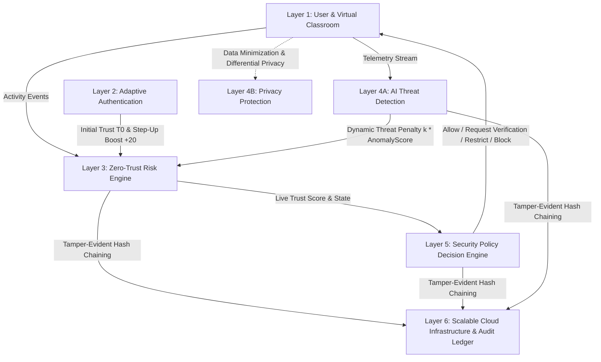

# 🛡️ VirtualClassroom: Activity-Aware Continuous Trust Architecture

> **A 6-Layer Secure, Privacy-Preserving Virtual Classroom Architecture with Continuous Trust & Dynamic Capability Permissions.**

---

## 🌟 Core Idea

In traditional systems, trust is evaluated only once at login. In **VirtualClassroom**, the **Trust Score is never static**—it is evaluated continuously throughout the active session based on behavioral telemetry, focus patterns, and network signatures.

Every capability in the classroom has its own security threshold:
- **Lecture View**: Threshold `20`
- **Classroom Chat**: Threshold `40`
- **Microphone & Camera**: Threshold `50`
- **Screen Share**: Threshold `70`
- **File & Resource Download**: Threshold `75`
- **Exam Submission**: Threshold `85`

---

## 🏛️ 6-Layer Architecture Overview



### 1️⃣ Layer 1: User & Virtual Classroom
- **Meeting Room**: Real-time video conferencing, screen sharing, ephemeral classroom chat, lecture resource panel, and proctored exam mode.
- **Continuous Event Collector**: Monitors join/leave, tab switches (`visibilitychange`), window blur/focus, chat frequency, network/IP shifts, and screen share requests.
- **Student View**: Live trust score pill & color badge (🟢 High / 🟡 Moderate / 🔴 Low), real-time capability matrix, and one-click Step-Up verification.
- **Teacher View**: Live class matrix with all student trust scores, anomaly indicators, and manual score overrides.
- **Exam Mode**: Full-screen lock, strict tab-switch penalty tracking, and exam submission validation (Threshold 85).

### 2️⃣ Layer 2: Adaptive Authentication
- **Initial Trust ($T_0$) Table**:
  - WebAuthn Passkey + Known Device = `80`
  - 2FA OTP Verified = `55`
  - Guest / Unverified = `30`
- **In-Class Step-Up Verification**:
  - Triggered whenever trust falls near a capability threshold ($T \ge \text{threshold} - 15$) or elevated capability is requested.
  - Verification via Hardware Passkey (WebAuthn biometric) or Authenticator TOTP.
  - **Success Reward**: Immediate `+20` Trust Score boost!

### 3️⃣ Layer 3: Zero-Trust Continuous Risk Engine
- Continuous Trust Score Update Formula:
  $$T(t+1) = \text{clamp}\left(T(t) \times \lambda + \text{positive} - \sum (w_i \times \text{negative}_i), 0, 100\right)$$
  - $\lambda = 0.995$: Gradual baseline stability factor
  - $\text{positive}$: Compliant engagement rewards, successful step-up verification (`+20`)
  - $\sum (w_i \times \text{negative}_i)$: Penalties for tab hopping (`-10`), rapid bursts (`-20`), chat flood (`-15`), exam focus loss (`-25`), and AI anomaly penalty.

### 4️⃣ Layer 4A: AI Threat Detection
- **Sliding-Window Feature Extractor**: Analyzes tab switches/min, chat rate/min, IP network hops, failed step-up attempts, and reconnection bursts.
- **Multivariate Anomaly Model**: Isolation-Forest inspired baseline anomaly scoring $\in [0, 1]$.
- **Dynamic Anomaly Penalty**: $\text{penalty} = k \times \text{anomaly\_score}$ ($k = 30$).
- **Instant Teacher Alerts**: Real-time alerts sent to instructor with reason codes and severity classification (`LOW`, `MEDIUM`, `HIGH`, `CRITICAL`).

### 5️⃣ Layer 4B: Privacy Protection
- **Data Minimization (Privacy by Design)**:
  - Strictly logs event types, score deltas, and policy codes.
  - Chat text bodies, video frames, and private notes are **NEVER logged or stored**.
- **Student Privacy Consent Notice**: Explicit transparency banner informing students of focus telemetry upon entering the classroom.
- **Differential Privacy ($\epsilon = 0.5$)**: Laplace mechanism noise toggle on the Teacher Dashboard to protect individual student telemetry privacy while preserving aggregate analytics.

### 6️⃣ Layer 5: Security Policy Decision Engine
- **Dynamic Policy Rules**:
  - $T \ge \text{threshold} \implies$ **ALLOW**
  - $T \ge \text{threshold} - 15 \implies$ **REQUEST_VERIFICATION** (triggers Step-Up prompt)
  - $T \ge \text{threshold} - 30 \implies$ **RESTRICT** (capability disabled)
  - $T < 20 \implies$ **BLOCK** (Probation lock + instructor alert)
- **Immediate Enforcement**: Active screen share is instantly revoked if trust drops below `70`; mic is automatically muted if trust drops below `50`.

### 7️⃣ Layer 6: Scalable Cloud Infrastructure & Audit Ledger
- **Cryptographic SHA-256 Hash Chaining**: Every trust score change and policy decision is appended to a tamper-evident audit ledger:
  $$\text{Hash}_n = \text{SHA256}(\text{Hash}_{n-1} + \text{Payload}_n)$$
- **Telemetry & Monitoring**: Prometheus/Grafana style telemetry with sub-15ms decision latency, trust distribution histogram, and verifiable ledger export (`.json`).

---

## 🚀 Getting Started

### 1. Prerequisites
- Node.js (v18+)
- MongoDB (running locally or MongoDB Atlas URI)

### 2. Installation
```bash
# Clone the repository
git clone https://github.com/Vipuulsharma/virtual-classroom.git
cd virtual-classroom

# Install frontend dependencies
npm install

# Install backend dependencies
cd server
npm install
cd ..
```

### 3. Environment Variables
Create a `.env` file in `server/`:
```env
PORT=5000
MONGO_URI=mongodb+srv://<username>:<password>@cluster0.mongodb.net/virtual_classroom?retryWrites=true&w=majority
JWT_SECRET=your_super_secret_jwt_key
FRONTEND_URL=http://localhost:5173
```

### 4. Running Locally
Run both client and server concurrently:
```bash
# Terminal 1: Start Backend Server
cd server
node server.js

# Terminal 2: Start Vite Dev Server
npm run dev
```

Visit `http://localhost:5173` to explore the classroom!

---

## 🔒 Security & Privacy Guarantees
- **End-to-End Encryption in Transit**: TLS 1.3
- **Tamper-Evident Ledger**: SHA-256 Merkle / hash-chained records with chain verification API
- **WebAuthn W3C Standard**: Hardware-backed biometric authentication (Touch ID, Windows Hello, Face Unlock)
- **Zero-Trust Capability Enforcement**: Sub-10ms policy decisions evaluated on every request
